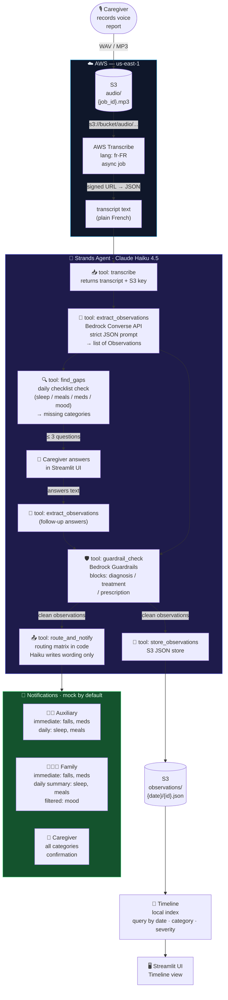
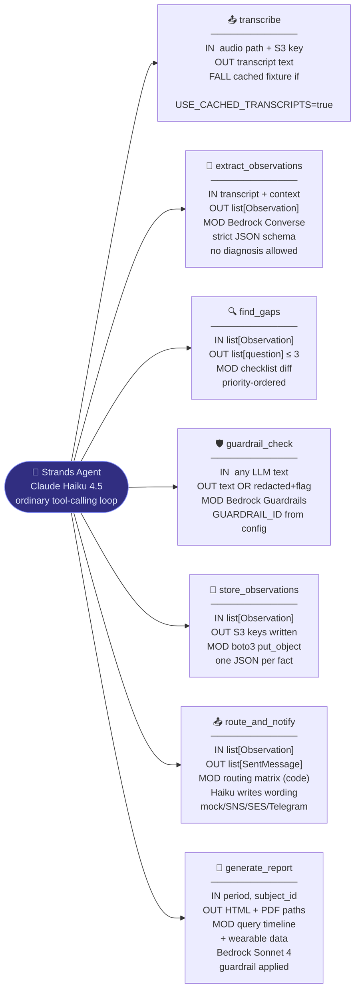
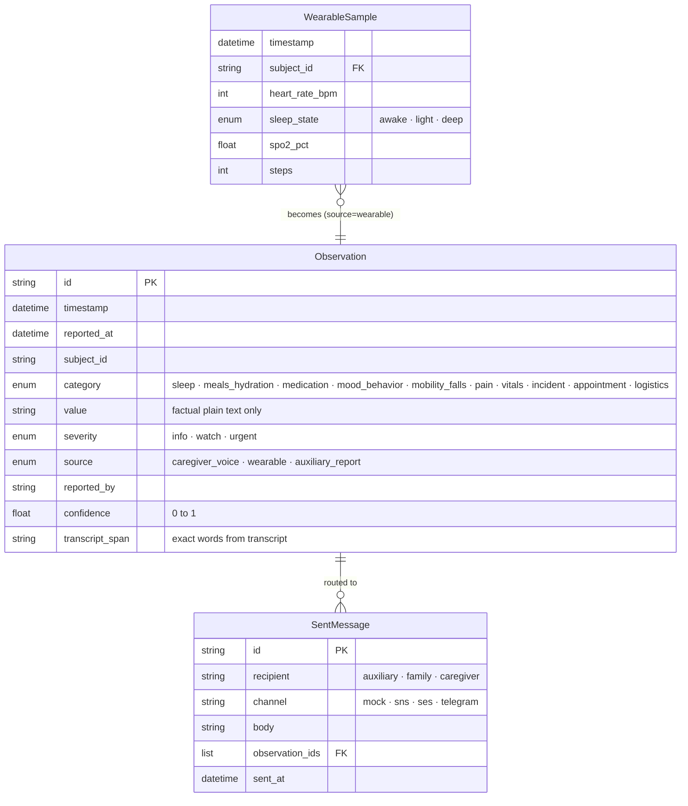
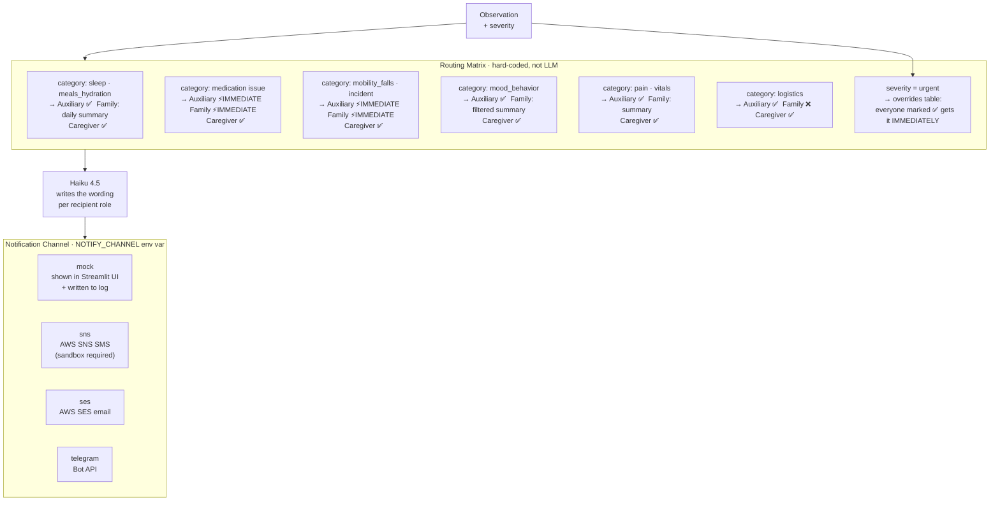
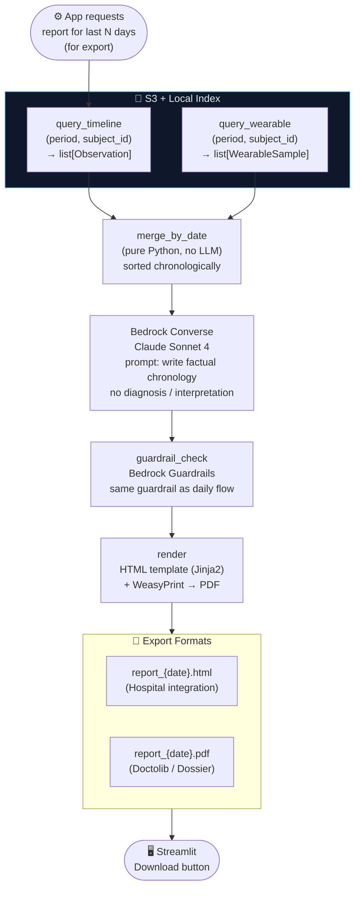
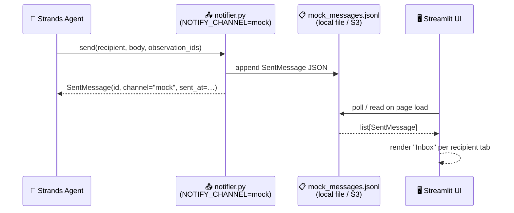
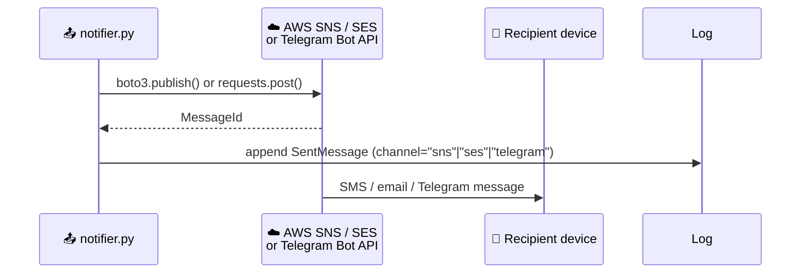
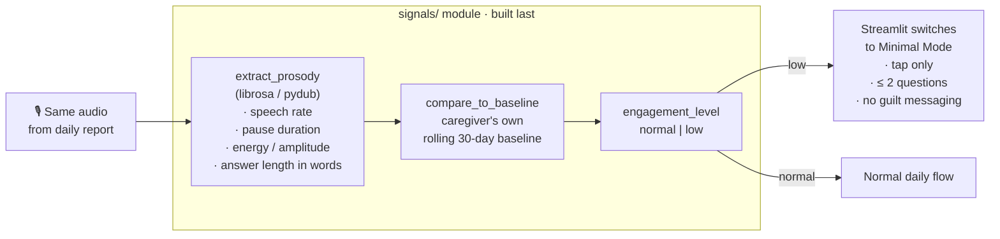

# Karis — Technical Architecture

## 1. Daily Flow: Voice → Timeline + Notifications

---

## 2. Strands Agent — Tools Catalogue

---

## 3. Data Contracts — What Flows Between Tools

---

## 4. Routing Matrix — Who Gets What

---

## 5. Report Flow — Timeline → PDF Export (Doctolib / Hospital)

---

## 6. Mock Notification API — How Recipients "Receive" Messages

During the demo all messages go through a **mock channel**. The mock is a thin in-process bus — no real network call — so the demo works without SNS/SES setup.

**When a real channel is configured (`sns`, `ses`, `telegram`):**

---

## 7. Engagement Signal (Optional) — Caregiver Burnout Detection

---

> **Key rule:** The LLM touches **wording only**. Every routing decision, every guardrail check, every tool invocation order is controlled by code. The agent can re-order tool calls but cannot invent new recipients or bypass the matrix.
